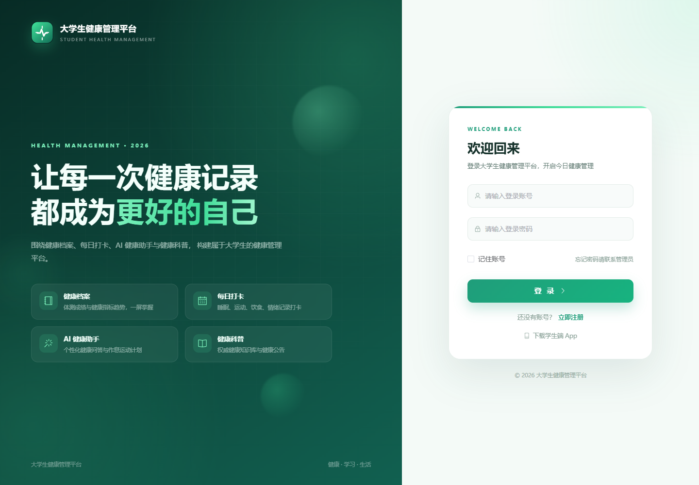
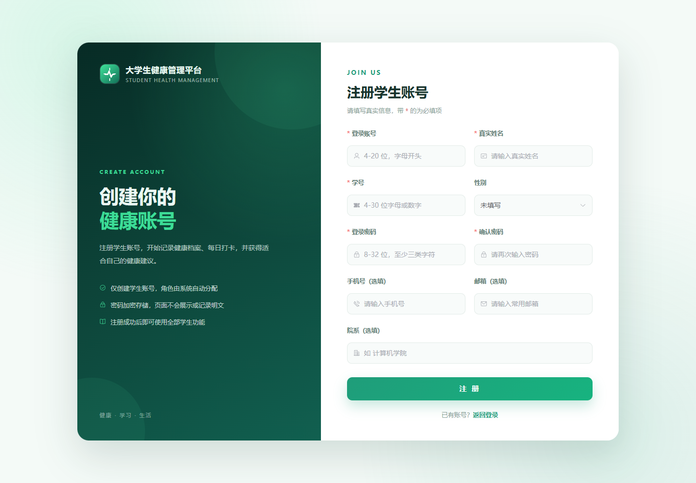
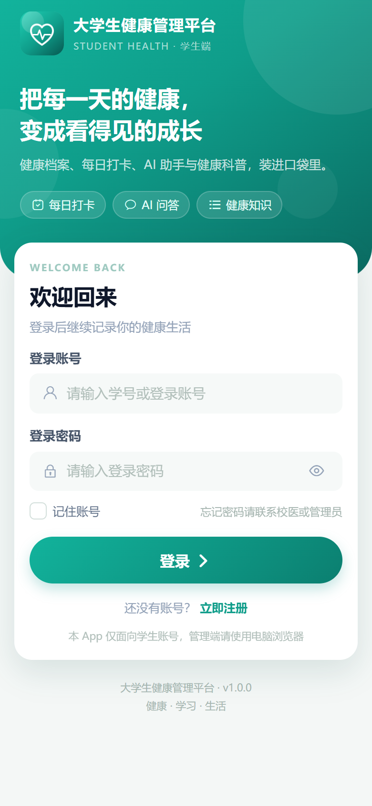
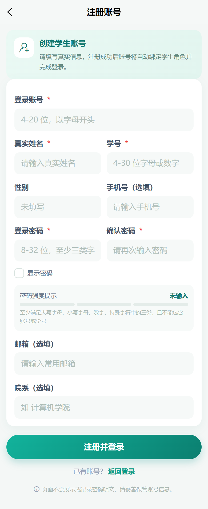
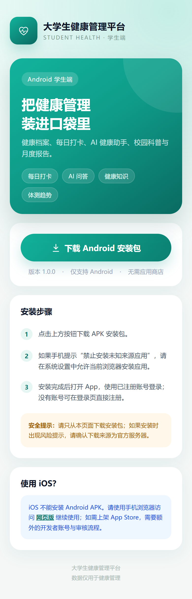

# 大学生健康管理平台

> 面向高校学生的健康管理全栈项目：Spring Boot 后端 + Vue 3 管理端 + uni-app 学生端，覆盖健康档案、每日打卡、AI 健康助手、健康知识库、消息通知、统计报表和 RBAC 权限管理。


## 项目简介

本项目是一个前后端分离的学生健康管理平台：

- **PC 管理端**：面向超级管理员、校医/科普管理员和学生，负责用户权限、健康数据、知识库、消息、报表和系统管理。
- **学生端 App**：基于 uni-app，支持 H5 和 Android，提供健康档案、每日打卡、AI 问答、健康知识、消息和月度报告。
- **后端**：Spring Boot 多模块工程，提供 JWT 认证、RBAC 权限、健康业务、AI 对话、消息预警和统计报表接口。

## 功能特性

### 认证与权限

- JWT Access Token + Refresh Token，Redis 会话管理
- 用户、角色、菜单、按钮权限（RBAC）
- 学生自助注册、管理员创建账号、密码修改/重置、强制下线
- 登录审计、操作日志、账号禁用

### 健康管理

- 健康档案：身高体重、BMI、血型、慢病史、过敏史、紧急联系人
- 体测成绩：历年体测数据、趋势图、Excel 导入导出
- 每日打卡：睡眠、运动、饮食、情绪、饮水量、打卡照片、补卡
- 数据质量校验和异常标记

### AI 健康助手

- 支持阿里百炼、Ollama、Mock 三种模式
- SSE 流式问答、多轮上下文、健康计划生成
- 健康知识库检索增强、安全兜底和失败降级

### 知识库与消息

- 健康文章分类、文章发布、内容审核、AI 知识素材管理
- 站内消息、校园公告、健康关怀、健康预警、已读状态

### 统计报表与系统管理

- 个人月报、健康看板、学院分布、健康台账、Excel 导出
- 系统参数、数据字典、操作日志、数据备份
- 本地磁盘 / 阿里云 OSS 两种文件存储

### 学生端下载

- PC 登录页和顶部栏提供“下载学生端 App”入口
- 手机扫码打开下载页，支持 APK 下载和微信内“在浏览器打开”提示

## 技术栈

| 层次 | 技术 |
| --- | --- |
| 后端 | Java 17、Spring Boot 2.7.18、Spring Security、MyBatis-Plus 3.5.1、JWT（jjwt 0.11.5）、Maven 多模块 |
| 数据库/缓存 | MySQL 5.7/8.0、Redis 6/7 |
| PC 管理端 | Vue 3、TypeScript、Vite、Element Plus、Pinia、Vue Router、ECharts、Axios |
| 学生端 | uni-app（Vue 3）、Pinia、uni-ui，支持 H5 和 Android |
| 部署 | Nginx 1.26、Docker Compose |
| 其他 | EasyExcel、阿里云 OSS、阿里百炼 / Ollama |

## 系统架构

```text
PC 管理端 (Vue)                 学生端 (uni-app H5 / Android)
        \                         /
         \                       /
          Nginx 80 / 8080
           ├── 静态资源：health-pc、health-app、download
           ├── /api      -> Spring Boot 8888
           └── /uploads  -> Spring Boot 8888
                          │
                          ├── MySQL 3306
                          ├── Redis  6379
                          ├── 本地文件 / 阿里云 OSS
                          └── 百炼 / Ollama / Mock
```

## 目录结构

```text
health-management-platform/
├── backend/                  # Spring Boot 多模块后端
│   ├── health-common-mng/    # 通用响应、异常、校验、Redis 工具
│   ├── health-auth-mng/      # 认证、用户、角色、菜单、系统管理
│   ├── health-core-mng/      # 健康档案、打卡、体测、知识库、AI、报表
│   ├── health-message-mng/   # 消息通知与健康预警
│   ├── health-web-mng/       # 启动模块与全局配置
│   └── pom.xml
├── frontend/
│   ├── pc/                   # Vue 3 PC 管理端
│   └── app/                  # uni-app 学生端（H5 + Android）
├── deploy/
│   ├── compose/              # Docker Compose 一键部署
│   ├── docker/               # 旧版手工 Docker 配置
│   └── nginx/                # Nginx 示例配置
├── docs/
│   └── 部署说明.md
├── sql/
│   ├── schema.sql            # 23 张表的完整结构
│   └── demo-data.sql         # 内置角色、菜单、字典和演示管理员
├── .env.example
├── .gitignore
├── LICENSE
└── README.md
```

## 快速开始

### 环境要求

- JDK 17
- Maven 3.8+
- Node.js 20.19+ 或 22.12+
- MySQL 5.7 / 8.0
- Redis 6 / 7

### 1. 初始化数据库

```bash
mysql -uroot -p -e "CREATE DATABASE IF NOT EXISTS health_management DEFAULT CHARACTER SET utf8mb4 COLLATE utf8mb4_general_ci;"
mysql -uroot -p --default-character-set=utf8mb4 health_management < sql/schema.sql
mysql -uroot -p --default-character-set=utf8mb4 health_management < sql/demo-data.sql
```

> `schema.sql` 包含 `DROP TABLE IF EXISTS`，只用于全新数据库，不要对已有数据的库执行。

### 2. 启动后端

```bash
cd backend
mvn clean package -DskipTests
java -jar health-web-mng/target/health-web-mng-1.0.0.jar
```

默认连接：

- MySQL：`localhost:3306/health_management`，`root / 123456`
- Redis：`localhost:6379`，无密码

如果和默认值不同，按根目录 `.env.example` 设置环境变量，例如：

```bash
export DB_USERNAME=root
export DB_PASSWORD=your-password
export REDIS_PASSWORD=
export JWT_SECRET=$(openssl rand -hex 32)
```

### 3. 启动 PC 管理端

```bash
cd frontend/pc
npm install
npm run dev
```

默认地址：`http://localhost:5173`，Vite 会把 `/api`、`/uploads` 代理到 `http://127.0.0.1:8888`。

生产构建：

```bash
npm run build
```

### 4. 启动学生端 H5

```bash
cd frontend/app
npm install
npm run dev:h5
```

默认也使用 `5173` 端口，两个前端同时启动时 Vite 会自动顺延端口。

Android App 构建：

```powershell
$env:VITE_API_BASE_URL="https://your-domain.com/api"
npm run build:app
```

然后用 HBuilderX 云打包。`frontend/app/src/manifest.json` 里的 `appid` 已替换为占位符 `__UNI__XXXXXXX`，请换成你自己的 DCloud appid。

### 演示账号

```text
管理员：admin / 123456
```

> 该账号只用于本地演示。部署到公网前请立即修改密码，并更换数据库、Redis、JWT 密钥。

学生账号可以在 PC 登录页或 App 登录页点击“立即注册”自助创建。

## 配置说明

| 变量 | 说明 |
| --- | --- |
| `DB_HOST` / `DB_PORT` / `DB_NAME` | MySQL 地址、端口、库名 |
| `DB_USERNAME` / `DB_PASSWORD` | MySQL 账号密码 |
| `REDIS_HOST` / `REDIS_PORT` / `REDIS_PASSWORD` | Redis 配置 |
| `JWT_SECRET` | JWT 签名密钥，务必使用随机长字符串 |
| `AI_PROVIDER` | `bailian` / `ollama` / `mock` |
| `AI_BASE_URL` / `AI_MODEL` / `DASHSCOPE_API_KEY` | AI 服务配置 |
| `STORAGE_TYPE` | `local` 或 `oss` |
| `UPLOAD_DIR` / `BACKUP_DIR` | 本地上传和备份目录 |
| `VITE_APP_DOWNLOAD_URL` | PC 二维码指向的 App 下载页地址，默认同源 `/download/` |
| `VITE_API_BASE_URL` | App 构建时的后端地址，必须是绝对地址 |

更多示例见：

- 根目录 `.env.example`
- `frontend/pc/.env.example`
- `frontend/app/.env.example`
- `deploy/compose/.env.example`

## Docker 部署

推荐使用 `deploy/compose/` 下的 Compose 编排。完整步骤见：

- [`docs/部署说明.md`](docs/部署说明.md)
- [`deploy/compose/README.md`](deploy/compose/README.md)

Compose 默认布局：

- PC：`80`
- App H5 + 下载页：`8080`
- 后端：仅绑定 `127.0.0.1:8888`
- MySQL / Redis：只在 Compose 内网，不发布端口

APK 放在：

```text
/opt/project/docker/nginx/html/download/health-app.apk
```

## 界面预览

| PC 登录 | PC 注册 |
| --- | --- |
|  |  |

| App 登录 | App 注册 |
| --- | --- |
|  |  |

| App 下载页 |
| --- |
|  |

## 安全说明

- 不要提交 `.env`、真实数据库导出、服务器密钥、APK 签名文件和真实学生健康数据
- 部署后立即修改 `admin` 密码、数据库密码、Redis 密码和 `JWT_SECRET`
- 生产环境建议使用 HTTPS，并把 App 的 `VITE_API_BASE_URL` 指向 HTTPS 地址
- 当前自助注册只校验学号唯一性，生产环境建议接入学校统一身份认证、学生名册或管理员审核
- AI Key 只通过环境变量注入，不要写进前端或配置文件

## 参与贡献

欢迎提交 Issue 和 Pull Request。提交前请确保：

- 不包含真实密钥、服务器地址和个人信息
- 不提交 `target/`、`node_modules/`、`dist/`、`unpackage/`、APK 和数据库 dump
- 前端改动通过 `npm run build`，后端改动通过 `mvn test`

## License

[MIT](LICENSE)
